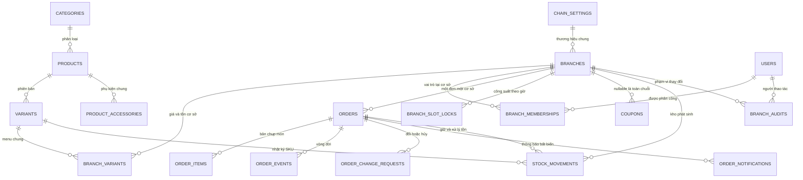

# Kiến trúc nhiều cơ sở

Tài liệu mô tả phần triển khai trong workspace ngày 26/11/2026. Migration không tự bật chế độ nhiều cơ sở hoặc nhận đơn. Commit, số liệu kiểm thử tổng và bằng chứng trình duyệt cần lấy từ biên bản nghiệm thu của đúng lần chạy; tài liệu này không xác nhận đã push, CI GitHub đạt hoặc triển khai public.

## Mô hình và phạm vi dữ liệu

Sơ đồ thể hiện quan hệ nghiệp vụ; liên kết cấu hình chuỗi với cơ sở là cách hợp nhất dữ liệu, không phải khóa ngoại bắt buộc. Danh mục, sản phẩm, biến thể, metadata, ảnh và phụ kiện dùng chung. Cặp `(branch_id, variant_id)` là duy nhất; không cộng chung hoặc chia tự động tồn giữa các cơ sở.

| Dữ liệu | Quy tắc |
| --- | --- |
| Thương hiệu | `chain_settings` giữ tên, logo và duyệt logo, giới thiệu, FAQ và duyệt nội dung chung, chính sách đơn, thông báo dữ liệu cá nhân. Chỉ quản trị chuỗi được đổi. |
| Cấu hình cơ sở | `branches.settings` giữ địa chỉ/liên hệ, lịch/nghỉ/ngoại lệ ngày, hình thức nhận, vùng/phí giao, ngưỡng miễn phí, phương thức thanh toán, ngân hàng, trả trước và công tắc nhận đơn. |
| Giá và chuẩn bị | Giá/thời gian chuẩn bị ghi đè trong `branch_variants`; `null` dùng giá biến thể/thời gian sản phẩm gốc. Giá 0 là giá riêng hợp lệ. |
| Tồn và bán | Luôn đọc tồn cơ sở. Thiếu dòng cơ sở không dùng tồn chung. Sản phẩm, biến thể chung và dòng cơ sở đều phải bật để bán. |
| Lịch/công suất | Theo `(branch_id, scheduled_at)`, tính chung đơn giao/nhận tại cơ sở đó. `calendar_exceptions` thay lịch/giới hạn của đúng ngày; ngày mở ngoại lệ cần giờ riêng. |
| Đơn | `orders.branch_id` xác định cơ sở. `branch_snapshot` lưu tên/địa chỉ/liên hệ tại lúc mua; `sales_context` lưu ngữ cảnh bán. Món, sự kiện, yêu cầu, liên kết thao tác và thư kế thừa qua `order_id`. |
| Đơn cũ | Chỉ gán phạm vi xác định được. Thông tin lịch sử thiếu được đánh dấu chưa biết, không lấy địa chỉ hiện tại làm địa chỉ lúc mua. Giữ mã, token, tiền và bản chụp cũ. |
| Mã giảm | `branch_id=null` là mã chuỗi, dùng chung bộ đếm hiện có; ID cụ thể là mã cơ sở. `code` vẫn duy nhất toàn hệ thống, không tạo hai mã cùng chữ ở hai cơ sở. |

Ảnh và metadata ảnh dùng chung theo URL, không nhân bản theo cơ sở. Bản sao lưu phải bao gồm schema mới và toàn bộ ảnh gốc/ảnh dẫn xuất theo [hướng dẫn vận hành](van-hanh.md).

## Ma trận quyền

Quản trị chuỗi là `users.role=admin`. Các vai trò cơ sở nằm trong `branch_memberships`; tài khoản vẫn là nhân sự nội bộ ở cấp hệ thống. Một người có thể có vai trò khác nhau tại các cơ sở. Cả tài khoản và phân công phải hoạt động.

**ĐS** nghĩa là phải được cấp thêm `can_reconcile` tại đúng cơ sở. **Sớm** là trước mốc chính sách dành cho khách trong [vòng đời đơn](vong-doi-don.md). Mọi thao tác đều kiểm tra lại quyền ở máy chủ.

| Hành động | Quản trị chuỗi | Quản lý | Nhân viên | Bếp | Kế toán |
| --- | --- | --- | --- | --- | --- |
| Tạo cơ sở, quản lý tài khoản/phân công | Có | Không | Không | Không | Không |
| Menu/ảnh/phụ kiện chung, thương hiệu | Có | Không | Không | Không | Không |
| Giá/tồn/chuẩn bị riêng, cấu hình cơ sở | Có | Có | Không | Không | Không |
| Mã giảm cơ sở | Có | Có | Không | Không | Không |
| Mã giảm toàn chuỗi | Có | Không | Không | Không | Không |
| Hàng đợi, chi tiết và báo cáo cơ sở | Có | Có | Có | Không | Có, dữ liệu được giảm |
| Tổng quan/báo cáo/CSV toàn chuỗi | Có | Không | Không | Không | Không |
| Xác nhận/xử lý đơn, đổi giờ hợp lệ | Có | Có | Có trong mốc sớm | Không | Không |
| Chuẩn bị và sẵn sàng nhận | Có | Có | Có | Có, đúng hai bước này | Không |
| Hủy muộn/ngoại lệ trả trước/xác minh lead time cũ | Có | Có, cần lý do/chính sách | Không | Không | Không |
| Phân loại tồn sau hủy | Có | Có | Không | Không | Không |
| Thu COD tại mốc hợp lệ | Có | Có | Có | Không | ĐS |
| Đối soát chuyển khoản/ghi hoàn tiền | Có | ĐS | ĐS | Không | ĐS |

Kế toán không được xử lý trạng thái. Chi tiết/CSV kế toán bỏ email, số điện thoại, địa chỉ giao, lời chúc và ghi chú riêng theo chính sách máy chủ hiện hành. Màn hình bếp chỉ có mã đơn, giờ, hình thức nhận, trạng thái và món cần làm; không nhận liên hệ khách hoặc thanh toán. Vai trò bếp không thể được cấp đối soát bằng cách sửa form.

Đổi vai trò, hoạt động, quyền đối soát, mật khẩu hoặc email nội bộ cập nhật phiên bản ủy quyền, thu hồi phiên DB và ghi audit. Đổi phân công cơ sở cũng tăng phiên bản. Bằng chứng TOTP gồm quyền/phân công hiện tại; phiên cũ phải đăng nhập/xác thực lại kể cả khi driver phiên không phải DB.

## Chọn cơ sở và giao diện

- Khách chọn cơ sở trên điện thoại/desktop. `POST /co-so/chon` chỉ nhận cơ sở hoạt động. Đổi khi có giỏ cần xác nhận xóa giỏ; không trộn bánh hai cơ sở.
- Session `branch_id` của khách khác `admin_branch_id` của quản trị. Đổi cơ sở quản trị không đổi giỏ mua hàng.
- `cart_branch_id` ràng buộc giỏ. Tab sản phẩm/giỏ cũ gửi `branch_id` không khớp bị từ chối. Báo giá ràng buộc khóa yêu cầu, cơ sở, hình thức nhận, vùng, giờ, phương thức, cấu hình và giá; máy chủ vẫn tính lại khi đặt.
- Nếu cơ sở bị ẩn, khách được chuyển sang cơ sở hoạt động đầu tiên nhưng không âm thầm mang theo giỏ cũ. Phải xác nhận bỏ giỏ hoặc xử lý lại.
- `POST /quan-tri/chon-co-so` chỉ nhận cơ sở có quyền mới nhất. Mở đơn từ báo cáo chuỗi dùng POST đổi ngữ cảnh và kiểm tra đơn thuộc cơ sở đích.
- Tra cứu token/lịch sử đơn của chính khách không phụ thuộc menu đang chọn. Quyền xem khác quyền đổi/hủy; thao tác chạy trong phạm vi đơn đã lưu. Mua lại dùng giá/tồn cơ sở hiện chọn và hiển thị rõ trước thao tác.

Cơ sở mới luôn ẩn, tạm ngừng nhận đơn, tồn 0 và phiên bản chưa bật. Không sao chép địa chỉ/ngân hàng cơ sở A thành dữ liệu thật của B. Ẩn rồi bật lại cơ sở không tự mở nhận đơn.

Giai đoạn này API quản trị chỉ nhận `Asia/Ho_Chi_Minh`; chưa hỗ trợ vận hành nhiều múi giờ/ngoài Việt Nam. Cột timezone và snapshot chuẩn bị cho mở rộng sau. URL thực đơn hiện phụ thuộc session nên chế độ nhiều cơ sở giữ `noindex` và không phát Product Offer theo session; cần thiết kế URL cơ sở ổn định trước khi nghiệm thu SEO public.

## Transaction và thứ tự khóa

MySQL `REPEATABLE READ` có thể tạo snapshot trước khi chờ người khác đổi cấu hình, quyền hoặc tồn. Khóa xong nhưng tiếp tục đọc snapshot cũ vẫn có thể làm sai quyết định bán hàng. Các luồng ghi phải dùng locking/current read cho dữ liệu quyết định sau khi lấy khóa.

1. Thay quyền khóa user ID tăng dần rồi phân công liên quan. Thao tác đơn kiểm tra quyền mới nhất trong transaction.
2. Bán hàng lấy khóa chia sẻ dòng cơ sở rồi cấu hình chuỗi. Đơn ở SKU/khung khác nhau có thể cùng tiến hành; không dùng một mutex độc quyền cho cả cơ sở.
3. Sửa cấu hình riêng lấy khóa độc quyền cơ sở rồi chuỗi. Sửa menu chung khóa **mọi dòng cơ sở theo ID tăng dần trước khi khóa chuỗi**, rồi đọc khóa sản phẩm/biến thể hiện tại. Không xen kẽ “A → chuỗi → B”, vì có thể tạo vòng chờ với người sửa cấu hình B.
4. Đặt/hủy có mã giảm khóa coupon trước khung và kho. Coupon chuỗi dùng một dòng chung để không vượt lượt cuối giữa hai cơ sở.
5. Khung giờ được khóa theo cơ sở/giờ đã sắp xếp; kho theo SKU tăng dần trong đúng cơ sở. Đổi lịch giữ giờ cũ/mới và chỉ chuyển bộ đếm khi kiểm tra thành công.
6. Đơn có khóa riêng khi cập nhật. Khóa yêu cầu checkout duy nhất ngăn cùng idempotency key tạo đơn tại hai cơ sở. Transaction ghi đơn, tiền, tồn, bộ đếm, sự kiện và yêu cầu gửi thư cùng kết quả commit.

Các transaction ghi chính thử lại deadlock hữu hạn; đây không thay thế thứ tự khóa. Các bài tranh tồn/khung/lượt mã và đọc snapshot phải chạy MySQL schema `_test` riêng; SQLite không chứng minh hành vi khóa MySQL.

Hủy sớm hoàn đúng tồn cơ sở một lần và giải phóng khung. Hủy sau chuẩn bị không tự nhập lại tồn bán; quản lý phải kiểm tra và phân loại. Quy tắc trả lượt mã độc lập với quy tắc nhập lại kho.

## Jobs, cache và vận hành

`Branches` được đăng ký theo request scope, không giữ cơ sở của người trước trong singleton. Worker không dùng session: job tìm đơn đã lưu, chạy `Branches::run(order.branch_id, ...)` và luôn phục hồi ngữ cảnh khi kết thúc.

Thông báo giữ nội dung/người nhận bất biến theo sự kiện, khóa sự kiện chống tạo lặp và Message-ID ổn định. Thử lại SMTP không đổi kết quả đơn. Nếu SMTP đã nhận nhưng kết nối chết trước phản hồi, không thể bảo đảm gửi đúng một lần tuyệt đối; đối chiếu Message-ID khi điều tra.

Cache bổ sung sau này phải chứa branch ID và phiên bản cấu hình cho dữ liệu phụ thuộc cơ sở; không dùng SKU/giờ/bộ lọc đơn lẻ làm khóa chung. Dữ liệu tổng chuỗi phải thể hiện phạm vi và quyền. Ảnh dùng chung theo URL. Đơn, báo giá, tài khoản và quản trị tiếp tục là phản hồi riêng tư, không cache công khai. Node SSR chỉ nhận phép chiếu công khai đã giới hạn, không nhận phân công, token, giỏ hoặc thông tin khách.

`php artisan bakery:preflight --branch=ID` kiểm một cơ sở; bỏ tùy chọn kiểm các cơ sở hoạt động. DB/ảnh, email được phép, TOTP, worker/scheduler, cảnh báo và khôi phục tiếp tục theo [hồ sơ vận hành](ban-giao-van-hanh.md). Mỗi cơ sở cần người xử lý đơn, đối soát và hỗ trợ/sự cố được chỉ định.

## Chuyển đổi và nghiệm thu

Đọc [backfill, verify, activate và rollback-read](multi-branch.md) trước khi đổi chế độ. Giữ nhận đơn đóng, sao lưu và đóng băng mọi thao tác ghi trong cửa sổ chuyển đổi. Không sửa trực tiếp trạng thái, baseline hoặc bộ đếm để ép verify đạt. `--rollback-read` chỉ đổi chế độ đọc khi đủ tương thích, không xóa dữ liệu hay tự phục hồi DB.

Nhóm kiểm thử gồm migration/backfill, catalog/config, phân quyền, checkout và các ca đồng thời MySQL, cùng bộ vòng đời hiện có. Ghi đúng commit, môi trường, người thử, kết quả, bằng chứng đã che dữ liệu riêng và mục chưa xác minh. Kết quả tổng cuối đợt này chờ chốt trong biên bản tích hợp; local không thay phê duyệt menu, nhân sự, ngân hàng hoặc dịch vụ thật của tiệm.
