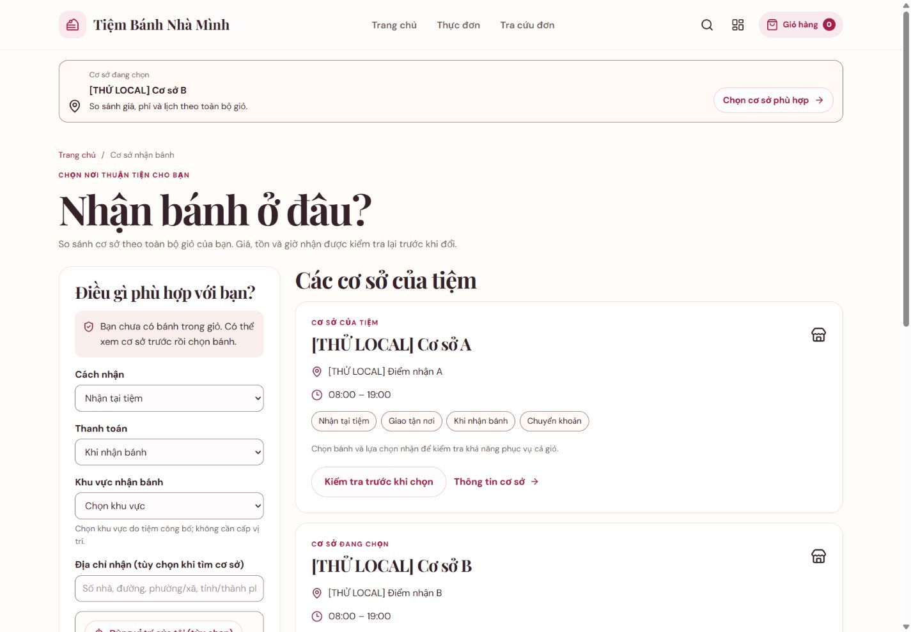

# Biên bản local: vị trí, chuyển cơ sở và giao nhận

Ngày 27/11/2026, người triển khai/thử: Codex. Nguồn kiểm thử backend đầy đủ: **`f85f603dca447d8240a05161ffc0a59f1cd86fce`**; giao diện cuối: **`c5cb8ca45b5108b13749756a964615f7f3588f1b`**. Bổ sung sau chỉ đổi JS/CSS và bài JS, đã đối chiếu Git xác nhận backend/migration/route/bài PHP giữ nguyên. Nối tiếp nền nhiều cơ sở `9443442`; không triển khai public, không push GitHub trong công việc này.

## Môi trường và giới hạn

| Phần | Môi trường thực sự đã dùng |
| --- | --- |
| Web | `http://127.0.0.1:18946`, chỉ bind loopback, `APP_ENV=local`, không lập chỉ mục. |
| DB web | MySQL 8.4.13, `127.0.0.1:33317`, schema mới `tiembanh_locations_demo_test`; 7 đơn seed cũ, thêm 1 đơn từ trình duyệt. |
| DB PHPUnit | Schema riêng `tiembanh_locations_phpunit_test`; SQLite `:memory:` kiểm nghiệp vụ tuần tự. Không dùng DB phát triển cổng 33316 hoặc schema nâng cấp trước. |
| Ảnh, session, cache, mail | Tách trong `work/locations-20261127/runtime-*`; private mail ở `runtime-storage/app/private/mail.log`. Không kết nối SMTP hoặc nhà vận chuyển thật. |
| Trình duyệt | In-app browser, viewport 320/390/768/1440 px; không phải thiết bị điện thoại vật lý hoặc nghiệm thu trình đọc màn hình độc lập. |
| Cấu hình | Hai cơ sở có nhãn `[THỬ LOCAL]`, vùng `local-core`, ngân hàng/menu/ảnh mẫu có cảnh báo. Không nhập dữ liệu thật hoặc giả phê duyệt vận hành. |

Sau ca đã **tạm ngừng nhận đơn ở cả A và B**, đăng xuất tài khoản thử và trả viewport về mặc định. Trang tra cứu/giới thiệu cơ sở vẫn hoạt động. `allow_branch_transfers` mặc định của ứng dụng vẫn đóng; tham chiếu bật riêng trong fixture chỉ mang nhãn thử local, không dùng cho tiệm thật.

## Quy tắc đã triển khai

- Khách chọn một cơ sở cho toàn giỏ. Gợi ý xét toàn bộ SKU, phụ kiện, giá, lịch, lead time, vùng, phí, phương thức và công suất; thứ tự hòa điểm ổn định. Không có provider/pin được duyệt thì khoảng cách/ETA để chưa biết, chuyển về ưu tiên giờ nhận có dữ liệu.
- Nhập địa chỉ tay luôn dùng được; vị trí chỉ được hỏi khi khách bấm, pin phải xác nhận. Gợi ý không lưu địa chỉ. Chọn cơ sở có xác nhận rõ tạo draft mã hóa tối đa 30 phút cho checkout; sổ địa chỉ chỉ lưu sau consent và kiểm chủ sở hữu.
- Đổi cơ sở hiển thị giá/phí/giờ thay đổi, ký báo giá theo cả giỏ/cơ sở nguồn thật/cơ sở đích. Kiểm lại khi xác nhận và khi đặt; giữ nguyên giỏ cũ nếu không đáp ứng. Không chia giỏ tự động.
- Chuyển đơn chỉ trước sản xuất, chưa thu tiền, chưa phân chuyến; quản lý có quyền ở cả hai nơi, khách duyệt riêng. Giữ đích và giải phóng nguồn trong một transaction, không đổi mã/link cũ. Giá hoặc nguồn lực đổi thì giữ nguồn và xin báo giá mới.
- Đơn ngân hàng thêm đối soát cả hai nơi, cùng tài khoản nhận, xác nhận chưa thu và mã đối chiếu. Không chuyển đơn đã thu/đã làm; dùng hủy/kiểm kê/hoàn hiện có. Không tự bù chênh lệch hoặc chuyển tiền. Ngoại lệ cho chưa thu tại nguồn không mang sang đích.
- Điều phối có chuyến bất biến, người giao theo cơ sở, sẵn sàng/xuất/giao được/lỗi/hủy công việc/giao lại và xác nhận nhận tại tiệm. Bằng chứng bàn giao không đồng nghĩa đã thu tiền. Giữ từng lượt giao và khóa chống lặp; tài xế không có quyền đối soát.

Quy tắc chi tiết: [xếp hạng và riêng tư](locations-ranking.md), [chuyển cơ sở và tiền](branch-transfers.md), [ca giao nhận và ma trận quyền](dispatch-operations.md), [giao diện và hợp đồng API](location-dispatch-ui.md).

## Ca đã chạy và bằng chứng

| Ca | Kết quả, phạm vi bằng chứng |
| --- | --- |
| Khách vãng lai chọn bánh tại A | Trình duyệt 390 px: Bánh Kem Dâu 16 cm, lời chúc phí 15.000₫, không tạo tài khoản. |
| Địa chỉ tay, không cấp vị trí | Trình duyệt: vùng cấu hình + địa chỉ thử; chọn “khoảng cách gần nhất” khi chưa có provider → hiển thị chưa có ước tính và xếp theo giờ sớm nhất. Không mở hộp cấp quyền vị trí của máy. |
| Đổi giỏ A → B | Trình duyệt: tổng dự kiến 400.000₫ → 530.000₫, phí 25.000₫ → 55.000₫; checkbox xác nhận, giữ bánh/lời chúc/địa chỉ, kiểm lại tại checkout. |
| Từng món chưa đáp ứng khi đổi cơ sở | Trình duyệt trên nguồn UI `c5cb8ca`: giỏ A có 5 Bánh Kem Dâu 16 cm, B còn 4; hiển thị đúng dòng chưa đáp ứng, giá 360.000₫ → 460.000₫, thành tiền 1.800.000₫ → 2.300.000₫. Không cho giữ giỏ, không tự đổi/xóa giỏ, không đoán tồn bằng 0 hoặc hứa tổng chưa báo được. Panel không tràn ngang ở cả bốn kích thước. Không tạo thêm đơn hay giữ kho/khung. |
| Tạo đơn giao COD tại B | Trình duyệt: tạo đúng 1 đơn mới, id 8; tổng 530.000₫, giờ 28/11 10:00. Tra cứu vãng lai không lộ địa chỉ chi tiết. |
| Chuyển đơn B → A | Trình duyệt quản trị 1440 px: đề nghị tổng 400.000₫, giờ 28/11 16:00, khách xác nhận trên link mail local ở 390 px; quản lý thực hiện thành công. Giữ mã/link cũ, cập nhật cơ sở/giờ/tổng cho khách. |
| Đối chiếu kho/khung | DB: B `4→3` lúc đặt, A `15→14` giữ đích, B `3→4` giải phóng nguồn; đúng 3 movement. Mirror cũ của A=14. Khung B cũ=0, A mới=1. Không trừ thêm khi giao lại. |
| Giao lỗi → giao lại → giao được | Trình duyệt: hai chuyến/lượt, lượt 1 failed, lượt 2 delivered với tham chiếu thử. Đơn vẫn chưa thu sau bàn giao; nhân viên đối chiếu COD riêng rồi hoàn tất. Khách thấy completed/paid, tổng 400.000₫ trên link cũ. |
| Tài xế TOTP/phạm vi/dữ liệu tối thiểu | Trình duyệt: vào thẳng “Việc giao của tôi”, chỉ A, chỉ việc được phân; sau delivered không còn điện thoại/địa chỉ. HTTP/PHPUnit kiểm cả quyền chéo cơ sở, thu hồi membership và cấm tài chính. |
| Sổ địa chỉ opt-in | Trình duyệt: không tự có địa chỉ sau đơn/gợi ý; chủ động lưu sau consent, sửa được và ở lại trang tài khoản. DB có 1 payload mã hóa. CRUD chéo người/khóa tài khoản/corrupt payload kiểm tự động. |
| Thiếu tồn ở cơ sở gần, cơ sở khác đủ; ngoài vùng; fake lỗi/từ chối | Kiểm tự động bằng fixture có giới hạn tồn/khung/vùng khác, adapter manual/fake; không khẳng định đã thử GPS thật hoặc provider bên ngoài. |
| Tranh chuyển và checkout khung/SKU cuối | MySQL hai tiến trình barrier: chỉ một bên thắng; chuyển thua giữ kho/khung nguồn. Hai execute/propose cùng khóa không ghi lặp. |
| Hai lệnh giao cùng lúc | MySQL hai tiến trình: cùng khóa chỉ một lượt/bằng chứng/mail; khóa khác cùng phiên bản chỉ một lệnh thành công, không tự ghi thanh toán COD. |
| Ngân hàng chưa thu, đã thu, vào bếp, hủy điều phối | Kiểm tự động: chặn chuyển/chuẩn bị/giao trái điều kiện tiền; giữ COD; hủy công việc không hủy đơn/hoàn kho; ngoại lệ nguồn bị xóa khi chuyển; nhận tại tiệm cần bằng chứng rồi thu tiền riêng. Không dùng ngân hàng thật. |
| Mã giảm, sửa báo giá, hết hạn, quyền | Kiểm tự động: lượt mã chính đơn đang giữ; mã không còn áp dụng; báo giá/đơn đổi; link hết hạn/owner khác; nhân viên thiếu quyền; gửi lại cùng khóa/đổi payload. |
| HTML không JS, riêng tư | HTTP `/co-so` 200 có heading và cả hai cơ sở, `no-store, private`, `noindex, nofollow`; `/up` 200; `/tai-khoan/dia-chi` chưa đăng nhập → 302 đăng nhập. SSR từ chối trang địa chỉ/phê duyệt riêng. |
| Bố cục và bàn phím | `/co-so` tại 320/390/768/1440 không tràn ngang; courier 390 không tràn. Tab/Shift+Tab qua nút tìm và link sổ địa chỉ đúng thứ tự, focus có outline. Chưa đánh giá toàn diện WCAG bằng công cụ/trình đọc màn hình độc lập. |
| Thông báo | DB và worker local: 14/14 thư của đơn thử đã ghi gửi, 0 pending/failed jobs. Hai dispatch_started/assigned thuộc hai lượt riêng; không gửi thêm thư shipping/delivery_failed trùng mốc. Log chung không chứa địa chỉ/chỉ dẫn thử. |

Các ảnh chỉ chứa dữ liệu giả, không có password, secret TOTP hoặc URL token:



[Chọn cơ sở mobile](evidence/locations-20261127/mobile-locations.jpg) · [Checkout mobile](evidence/locations-20261127/mobile-checkout.jpg) · [Người giao mobile](evidence/locations-20261127/mobile-courier.jpg) · [Món thiếu tại cơ sở đích](evidence/locations-20261127/mobile-unavailable-line.jpg).

## Kết quả kiểm tra theo phiên bản nguồn

PHP/Pint/MySQL/SQLite chạy tại `f85f603`; mã backend ở `c5cb8ca` trùng hoàn toàn với bản đó. Lint/build/SSR/JS đã chạy lại tại `c5cb8ca`, cùng ca trình duyệt bổ sung. Không chạy lại SQL chỉ vì thay phần trình bày.

| Lệnh | Kết quả |
| --- | --- |
| `php vendor/bin/pint --test` | Đạt. |
| `npm run lint` | Đạt. |
| `npm run build` | Đạt. |
| `npm run test:ssr` | Đạt, 7 trang công khai; trang riêng bị từ chối. |
| `npm run test:orders` | 9/9 bài JS đạt, gồm ghép dòng theo khóa giỏ và phân biệt dữ liệu chưa biết với hết khả dụng. |
| PHPUnit SQLite | 226 bài: 203 đạt, 23 bỏ qua do yêu cầu MySQL; 3.457 assertions. |
| PHPUnit MySQL `--fail-on-skipped` | 226/226 đạt, 3.659 assertions, không skip. |

Log thành công đã rà soát và checksum ảnh ở [thư mục bằng chứng](evidence/locations-20261127/). CI hiện chạy lint/build/Pint/SSR/JS/SQLite/MySQL, không có bước deploy; chưa chạy GitHub Actions cho commit chưa push.

## Chạy lại và kiểm tra local

Trong workspace đã chuẩn bị, mở PowerShell tại `C:\tiembanhcuatoi`:

```powershell
. work/locations-20261127/runtime-profile.ps1 current
php artisan serve --host=127.0.0.1 --port=18946 --no-reload
# Trong terminal khác cùng profile, chỉ mở nhận đơn của fixture:
php work/locations-20261127/runtime-fixture.php open
php artisan queue:work --queue=order-mail,default --stop-when-empty --tries=3
# Đóng lại khi hết ca:
php work/locations-20261127/runtime-fixture.php pause
```

URL: `/co-so`, `/dat-banh`, `/quan-tri/giao-nhan`, `/tai-khoan/dia-chi`. Tài khoản, mật khẩu và cách nhập TOTP thủ công chỉ nằm trong **`work/locations-20261127/local-demo-access.md`** (ignored), không nằm trong báo cáo/Git. Không dùng chúng trên dịch vụ thật. Profile và script work là vật liệu local hiện tại, không nằm trong checkout mới; người cài mới dùng `.env.example`, migration/seed, quản trị cơ sở/phân công theo README và `tests/Support/BranchFixture.php` để chạy ca tự động.

Chạy test bằng `work/locations-20261127/run-full-tests.ps1 -Driver sqlite` hoặc `-Driver mysql` trên máy này. Với môi trường mới, cấu hình `APP_ENV=testing`, `DB_URL` rỗng, MySQL schema riêng hậu tố `_test`, storage/cache riêng, rồi dùng các lệnh trong bảng. Không chạy migrate rollback hoặc reset test trên DB đang bán. Những runtime cũ phải được backup và chạy đủ migration mới trước khi phục vụ bằng phiên bản này; không tự sửa DB phát triển hoặc sandbox trước trong ca này.

## Đầu vào thật còn chờ

| Hạng mục | Người phụ trách và tác động |
| --- | --- |
| Từng cơ sở: địa chỉ/điện thoại/giờ, tọa độ đã duyệt, vùng chung/ngoại lệ/phí/công suất, menu/giá/tồn/lead time | Chủ tiệm/quản lý xác minh. Thiếu thì chưa dùng gợi ý và lịch thử làm cam kết nhận đơn thật. |
| Cho phép chuyển đơn và người duyệt ở cả hai nơi; xác nhận quy trình tiền đến muộn, chênh lệch giá, trường hợp đã thu/đã làm | Chủ tiệm và đối soát chốt, ghi tham chiếu thật. Chính sách đã triển khai chặn các ca đã thu/đã làm; không giả lập việc cho phép những ca đó. |
| Người điều phối, tài xế, hỗ trợ, đối soát; quy ước bằng chứng, bàn giao COD, xử lý bánh sau giao lỗi | Chủ tiệm phân công membership/TOTP và đào tạo ca bán trước khi bật. |
| Nhà cung cấp bản đồ/vận chuyển, tài khoản/key/quyền gửi dữ liệu, ETA/SLA nếu muốn tích hợp | Chủ tiệm/đơn vị vận hành cung cấp ngoài Git. Hiện manual/fake không gọi dịch vụ thật và không hứa ETA. |
| Staging ngoài máy, HTTPS tin cậy, SMTP và hộp thư duyệt, giám sát ngoài máy, ngân hàng thật | Đơn vị vận hành/chủ tiệm cung cấp và nghiệm thu riêng. HTTP loopback/mail log local không thay xác nhận các dịch vụ này. |

Khi cần quay lui, khóa nhận đơn, giữ schema/lịch sử và chọn bản ứng dụng đã chứng minh tương thích cả **dữ liệu và nghiệp vụ giao nhận/chuyển đơn**. Không coi bản nền trước module này là ứng viên quay lui tự động sau khi đã phát sinh đơn/chuyến/chuyển cơ sở mới; chưa diễn tập một release candidate ngoài máy trong ca này.
